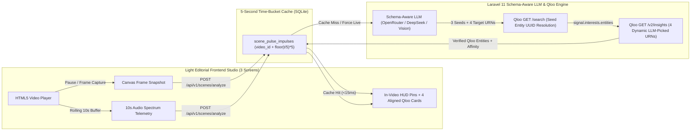

# ScenePulse
**Real-Time Multimodal Video Frame & 10s Audio Cultural Intelligence Engine — Powered by Qloo Taste AI**

[](./LICENSE)
[](https://qloo.com)

> **"Cultural discovery and contextual matches emerging directly from what is seen in a paused video frame and heard in the trailing 10-second audio window — powered by a schema-aware LLM planner and Qloo Taste AI."**

---

## The Problem & Our Breakthrough

Standard contextual video systems only match literal visual objects (*"there is a coffee cup -> show a coffee ad"*) or hardcode the same output categories for every clip. That approach misses the **cultural soul** of a scene and produces noisy, out-of-context recommendations.

**ScenePulse** turns every **video pause** into a precision cultural discovery moment:
1. **Paused Video Frame + 10s Audio Capture:** When playback pauses, ScenePulse captures the exact HTML5 `<canvas>` video frame (`480x270` Base64 JPEG) along with the trailing 10-second audio spectrum summary.
2. **Schema-Aware Multimodal LLM Planner:** We inject the complete **Qloo API specification** (`/search` + all 9 `/v2/insights` entity URNs) directly into the LLM system prompt. The LLM analyzes the visual frame and 10s audio window, extracts 3 concrete Qloo `/search` seed entities, and dynamically selects the **4 most contextually relevant Qloo `/v2/insights` URNs**:
   - `urn:entity:brand` (Brands & Craft Goods)
   - `urn:entity:place` (Cafes, Dining & Cultural Venues with dynamic `filter.location.query`)
   - `urn:entity:destination` (Cities & Travel Destinations)
   - `urn:entity:book` (Books & Cultural Literature)
   - `urn:entity:movie` (Cinema & Visual Storytelling)
   - `urn:entity:artist` (Musical Artists & Composers)
   - `urn:entity:podcast` (Podcasts & Spoken Word)
   - `urn:entity:tv_show` (Television & Docuseries)
   - `urn:entity:videogame` (Video Games — selected strictly when gaming/digital visuals are present, never on coffee, travel, or acoustic music scenes)
3. **Live Qloo `/search` & `/v2/insights` Execution:** Seed strings are resolved into canonical Qloo Entity UUIDs via `GET /search` and passed as `signal.interests.entities` into `GET /v2/insights` across the 4 LLM-selected URNs.

---

## System Architecture



---

## Multi-Provider LLM Support (OpenRouter / DeepSeek Ready)

ScenePulse supports switching LLM providers seamlessly via `backend/.env`:
- **OpenRouter (`AI_DEFAULT_PROVIDER=openrouter`):** Supports `deepseek/deepseek-chat` (DeepSeek V3/V4) and multimodal vision models (`google/gemma-3-27b-it`, `qwen/qwen2.5-vl-72b-instruct`) via `OPENROUTER_API_KEY`.
- **OpenAI-Compatible / TokenFactory / Gemini:** Supports `OPENAI_API_KEY`, `GEMINI_API_KEY`, or `NEBIUS_API_KEY` automatically.

---

## Quick Start (Docker Deployment)

```bash
docker compose up -d --build
```
- **Frontend UI (`http://127.0.0.1:5195`):** Serves the 3-screen light editorial application (`01 · Scene Showcase`, `02 · Live Frame & Qloo Proof Studio`, `03 · How It Works (Remotion)`) and proxies `/api/*` to the backend container.
- **Backend API (`http://127.0.0.1:8098`):** Runs migrations, seeds the 3 real short videos (`16s–28s`), and warms the 5-second time-bucket SQLite cache with live Qloo `/search` and `/v2/insights` calls.

To configure OpenRouter or update your Qloo API key in `backend/.env`:
```env
QLOO_SERVER_URL=https://hackathon.api.qloo.com
QLOO_API_KEY=your_qloo_hackathon_api_key

AI_DEFAULT_PROVIDER=openrouter
OPENROUTER_API_KEY=your_openrouter_api_key
OPENROUTER_DEFAULT_MODEL=deepseek/deepseek-chat
OPENROUTER_VISION_MODEL=google/gemma-3-27b-it
```

---

## API Reference

| Method | Endpoint | Description |
| :--- | :--- | :--- |
| `GET` | `/api/v1/health` | System, SQLite cache, Qloo API, and LLM readiness check |
| `GET` | `/api/v1/scenes/catalog` | Returns the 3 real showcase videos, active LLM/Qloo status, and pre-warmed 5s buckets |
| `GET` | `/api/v1/scenes/videos/{slug}` | Returns video metadata and all cached 5-second Qloo impulse buckets |
| `POST` | `/api/v1/scenes/analyze` | Analyzes a paused video frame (`frame_image_base64`) + 10s audio context and returns 4 dynamic Qloo `/v2/insights` matches |
| `GET` | `/api/v1/qloo/explore?q=Espresso&domain=brand` | Direct live Qloo `/search` + `/v2/insights` explorer across all 9 supported URNs |

---

## License

Released under the [MIT License](./LICENSE).
